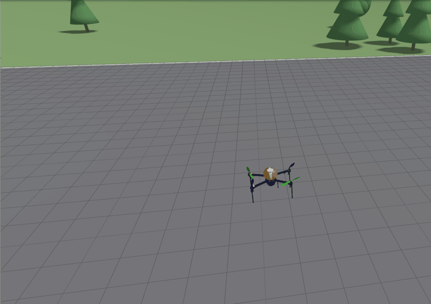
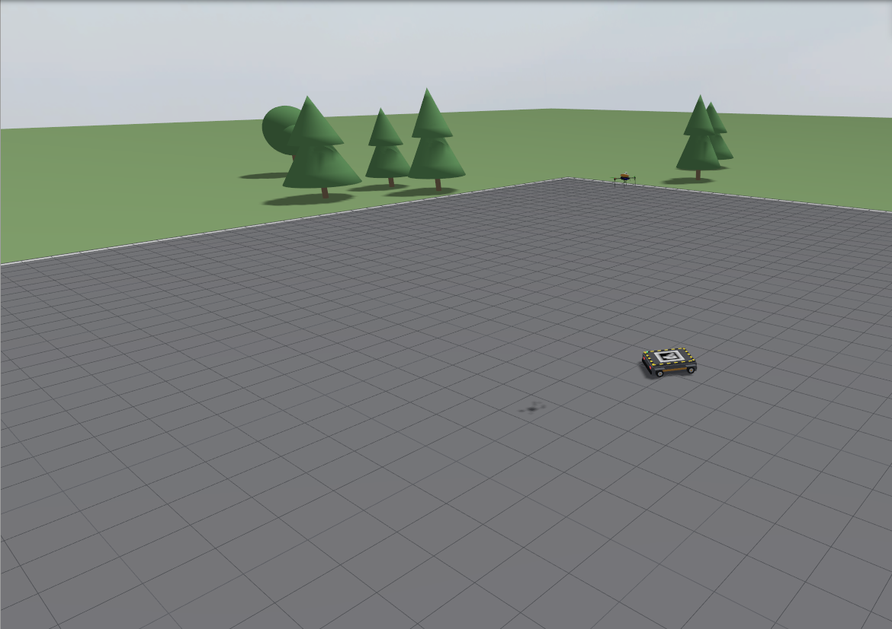
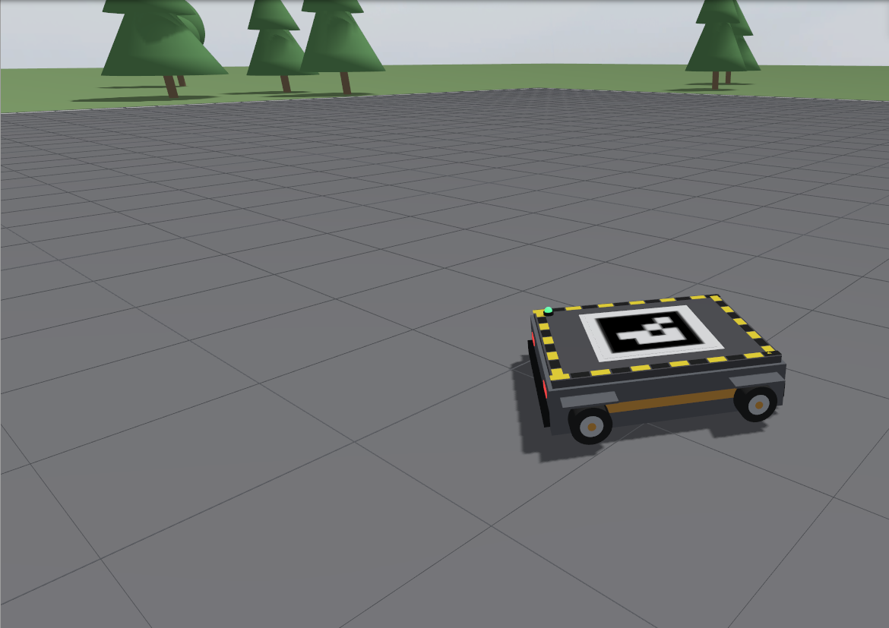
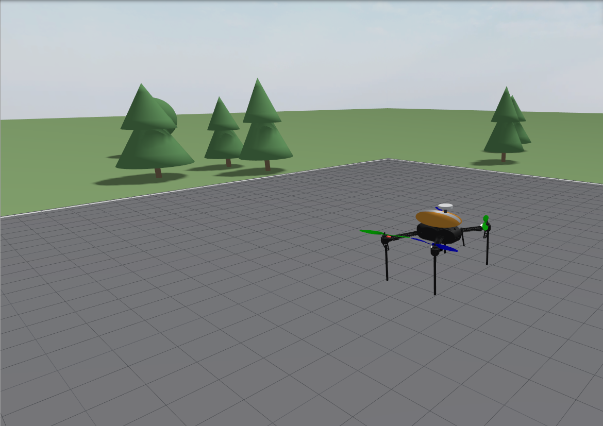
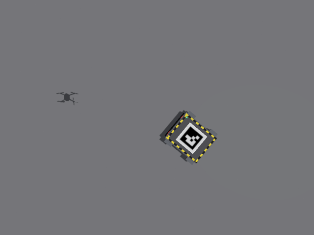
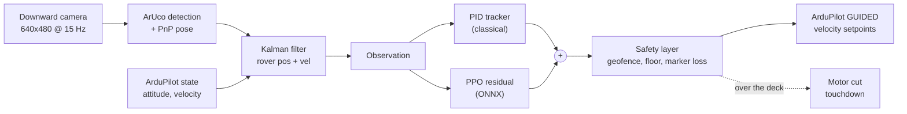

<div align="center">

# 🚁 Vision-Based Landing on a Moving Rover with Residual RL

**A quadcopter that finds, tracks and lands on a moving ground robot using only its downward camera,
with a PPO policy that learns to correct a classical controller.**




*Gazebo Harmonic + ArduCopter SITL, real time: the drone locks onto the ArUco marker, matches the
rover's motion and touches down on the deck.*

</div>

---

## ✨ Highlights

- **End-to-end stack:** Gazebo physics + real ArduPilot flight code (SITL) → camera → ArUco/PnP →
  Kalman filter → RL policy → MAVLink velocity commands. The same ONNX runtime and safety layer are
  built to run on a companion computer.
- **Residual RL:** PPO learns a *correction* on top of a tuned PID tracker,
  `a = clip(a_PID + 0.5·a_res)`. PPO from scratch got stuck in "dive" or "hover" local optima on
  moving targets; that negative result is measured and documented.
- **Measured, not claimed:** fixed scenario grid, thousands of episodes, 95% confidence intervals,
  3 seeds, ablations and a real-runtime SITL rehearsal.
- **Results:** in the fast simulator the residual policy lands **37–38% vs PID 31%** under full
  randomisation and **~35% faster**. In Gazebo it wins on curved paths (**9/30 vs 1/30** at 1.5 m/s,
  p = 0.012), while the overall rate is not significantly different (54% vs 50%).

## 🖼️ Gallery

<table>
<tr>
<td align="center"><br/><sub><b>Arena</b>: 56 m pad, the rover and the drone at the start</sub></td>
<td align="center"><br/><sub><b>Rover</b>: moving landing deck with the ArUco marker</sub></td>
</tr>
<tr>
<td align="center"><br/><sub><b>Drone</b>: ArduPilot iris + rigid downward camera</sub></td>
<td align="center"><br/><sub><b>Downward camera</b>: the raw 640×480 frame perception works on</sub></td>
</tr>
</table>

## 🧠 How it works



| Stage | What it is | Why |
|---|---|---|
| **A: fast env** | Vectorised numpy simulator with a drone model identified from SITL step responses | ~40k steps/s on a laptop GPU: 20M-step PPO runs in minutes |
| **B: Gazebo + SITL** | Real ArduPilot firmware, rendered camera, real ArUco detection | Tests what transfers: perception, latency, autopilot dynamics |
| **Deployment** | ONNX policy + numpy PID + safety filter on a 10 Hz loop | The exact code a Raspberry Pi would run, rehearsed against SITL |

Full design: [docs/ARCHITECTURE.md](docs/ARCHITECTURE.md) · step-by-step concepts and every
measurement: [LEARNING.md](LEARNING.md) · real-hardware plan: [docs/HARDWARE.md](docs/HARDWARE.md)

## 📊 Results

Scenario grid: static rover + {straight, circle, figure-8, random} paths × {0.5, 1.5, 2.5} m/s.
Success = touchdown on the deck with low relative velocity.

| Controller | Fast sim, full randomisation | Fast sim, nominal | Gazebo + SITL (n=130) |
|---|---|---|---|
| PID (tuned) | 31% | 48% | 50% · 7.1 s · 4.4 cm |
| **Residual PPO** (3 seeds) | **37–38%** | **51%** | 54% · **4.6 s** · 11.2 cm |
| ablation: easy→hard curriculum | 36% | 48% | – |
| ablation: no domain randomisation | 38% | 50% | – |
| pixel student (DAgger, CNN on raw frames) | 34.9% | – | – |

<table>
<tr>
<td></td>
</tr>
<tr>
<td></td>
</tr>
</table>

<table>
<tr>
<td width="50%"></td>
<td width="50%"></td>
</tr>
</table>

**What the numbers say**
- RL helps most where the PID struggles: **curved paths at 1.5 m/s** (fast sim: circle 28% vs 18%;
  Gazebo: 9/30 vs 1/30 across the three curved paths).
- It lands faster but **less centred** (11 cm vs 4 cm in Gazebo): a precision term is on the roadmap.
- **Nobody lands on curves at 2.5 m/s** (≤ 2%): the rover turns faster than the tracker can predict.
- **Deployment:** ONNX matches PyTorch to 1e-4 at 0.02 ms per inference; the real runtime landed on
  the moving deck in 2/3 SITL rehearsals.

<details>
<summary><b>What didn't work (and why it's documented)</b></summary>

- **PPO from scratch:** 8 reward/observation designs, all stuck in "dive" (works only on a static
  rover) or "hover-and-track" (never lands). An isolation experiment showed PPO *can* improve on
  moving targets from a good start: the problem was the starting basin, which residual RL fixes.
- **Curriculum and domain randomisation** did not help here; the curriculum slightly hurt on curves.
- **A first rich-scenery world** made the drone lose the rover. The cause was our own client parsing
  every visual's pose at 60 Hz in Python, which starved the control loop; fixed.

Details and numbers: [LEARNING.md](LEARNING.md) Steps 9–16.
</details>

## 🚀 Quick start

Requires Ubuntu 22.04, Gazebo Harmonic, ArduPilot (SITL build) and
[ardupilot_gazebo](https://github.com/ArduPilot/ardupilot_gazebo); paths are set in
`configs/paths.yaml` and `env.sh`. The trained policy is included in `results/runs/main_s0/`.

```bash
make venv && source env.sh && source .venv/bin/activate
python -m lander doctor          # checks the toolchain
make test-fast                   # 50+ unit tests, ~10 s
```

**Watch it land** (Gazebo window with the drone camera feed and a follow camera):

```bash
python -m lander eval --policy results/runs/main_s0 --stage gazebo --gui --rtf 1 --episodes 1 \
  --cells static:0,straight:0.5,circle:0.5,figure8:0.5,random:0.5,circle:1.5 --out tour
```

<details>
<summary><b>More commands</b></summary>

```bash
# one scenario, repeated; --policy pid for the baseline; --rtf 3 to run faster
python -m lander eval --policy results/runs/main_s0 --stage gazebo --gui --rtf 1 --kind circle --speed 1.5 --episodes 3 --out one

# the real deployment runtime (ONNX + safety layer + motor cut) against SITL
python -m lander deploy rehearse --run main_s0 --gui --rtf 1 --kind straight --speed 0.5 --episodes 1

# full evaluations -> results/eval/<out>/summary.md
python -m lander eval --policy results/runs/main_s0 --stage fast --out res_fast                    # ~15 s
python -m lander eval --policy results/runs/main_s0 --stage gazebo --episodes 10 --out res_gz      # ~20 min

# training (20M steps, ~10 min on a laptop GPU), pixel student, figures, README media
python -m lander train --run my_run --seed 0 --no-curriculum
python scripts/run_dagger.py
python scripts/make_figures.py
python scripts/capture_media.py
```

Run Gazebo jobs one at a time (they share SITL ports). Gazebo's own log goes to
`results/logs/gazebo.log`, SITL's to `.sitl/sitl.log`. `--gui` loads a showcase world, drone and
GUI layout; headless runs use the plain world all results were measured in.
</details>

## 🗂️ Repository layout

```
lander/
  perception/   ArUco detector, PnP, frames, Kalman filter
  envs/         fast vectorised env (Stage A) and Gazebo Gymnasium env (Stage B)
  baselines/    tuned PID visual-servoing controller
  training/     PPO (SB3), residual policy, curriculum
  eval/         scenario-grid evaluation, figures, terminal reports
  deploy/       ONNX export, 10 Hz runtime, safety layer, SITL rehearsal
  stretch/      DAgger pixel student
  sim/          Gazebo client, SITL launcher, system identification
gazebo/         worlds, rover + drone models, GUI layout
configs/        every parameter, one YAML per subsystem
docs/           architecture, hardware plan, figures, media, eval data
results/runs/main_s0/   released policy (final.zip, policy.onnx)
```

## 🛣️ Roadmap

- [ ] Re-run Gazebo evals after the pose-parsing performance fix
- [ ] Nested ArUco marker, so the camera keeps lock below 0.5 m
- [ ] Turn-aware (CTRV) rover filter for fast curved paths
- [ ] Fine-tune the residual in Gazebo to close the sim-to-sim gap; MPC baseline
- [ ] Pixel student on Gazebo frames; real-hardware flight ([plan](docs/HARDWARE.md))

## 🔧 Stack

Ubuntu 22.04 · Gazebo Harmonic 8 · ArduCopter SITL · ardupilot_gazebo · Python 3.10 ·
PyTorch 2 · Stable-Baselines3 2.9 · Gymnasium 1.4 · OpenCV 4.10 · pymavlink · ONNX Runtime
