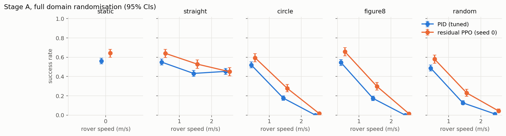
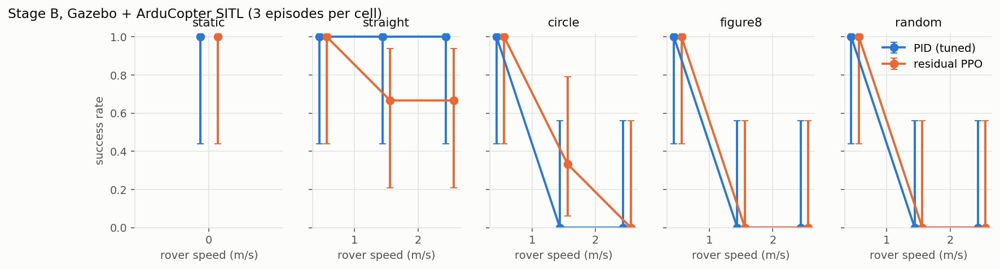
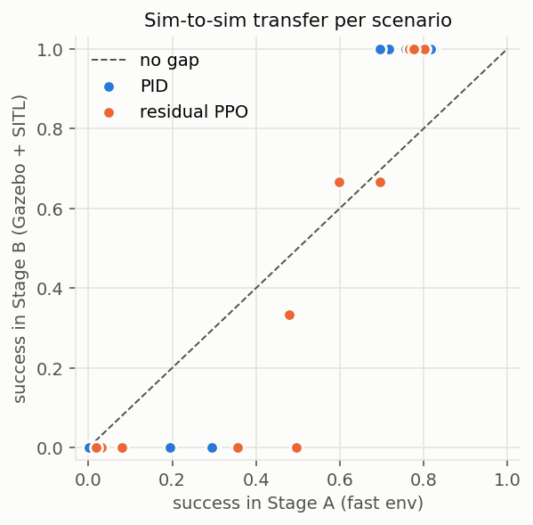
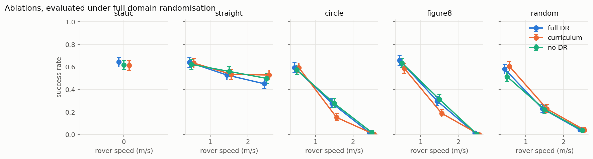
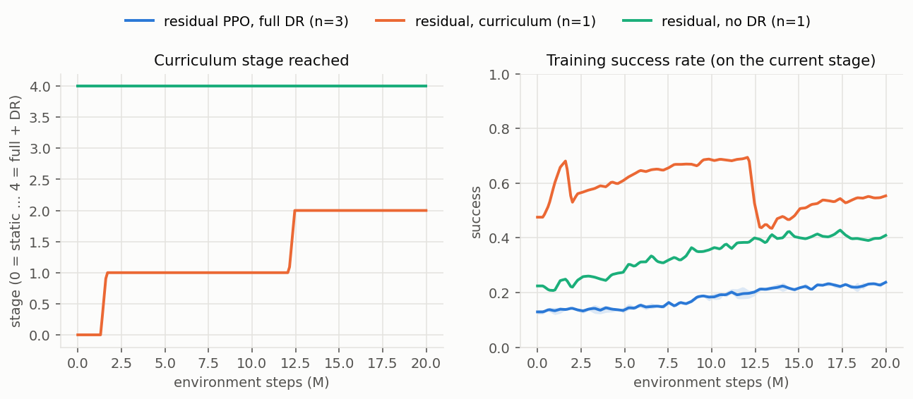
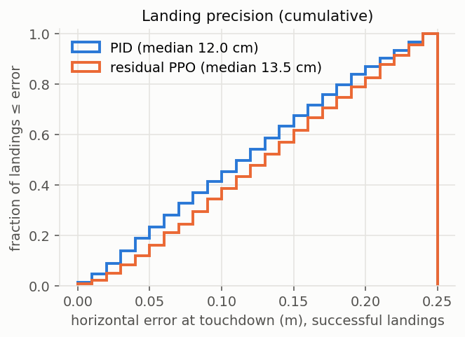

# Vision-Based Autonomous Landing on a Moving Platform with PPO

A quadcopter (Gazebo Harmonic + ArduPilot SITL) learns with PPO to track and land
on a moving rover carrying an ArUco marker, using its downward camera, with an
ONNX runtime and safety layer for a real companion computer.

See [docs/ARCHITECTURE.md](docs/ARCHITECTURE.md) for the design and
[LEARNING.md](LEARNING.md) for the concepts and measurements behind each step.

## Results (measured 2026-10-15)
The final controller is **residual PPO**: a tuned PID visual-servoing controller plus a
learned correction, `a = clip(a_PID + 0.5·a_res)`. PPO from scratch failed (dive / hover
local optima); that negative result is documented in LEARNING.md Step 9.

| Controller | Stage A, full DR | Stage A, nominal | Gazebo + SITL |
|---|---|---|---|
| PID (tuned) | 31% (n=13000) | 48% | 50% (42–58%, n=130), 7.1 s, 4.4 cm |
| **Residual PPO**, 3 seeds | **37–38%** (n=6500 each) | **51%** | 54% (45–62%, n=130), **4.6 s**, 11.2 cm |
| ablation: curriculum | 36% | 48% | – |
| ablation: no DR in training | 38% | 50% | – |
| pixel student (DAgger, Step 15) | 34.9% (n=5200) | – | – |

Grid: static + {straight, circle, figure-8, random} × {0.5, 1.5, 2.5} m/s; success =
touchdown within the marker with low relative velocity.

- **Stage A:** the residual beats the PID by ~7 points on every seed and lands ~35% faster;
  the gains are on curved and fast paths (circle 1.5 m/s: 28% vs 18%).
- **Gazebo (seed 0, 10 episodes per cell):** the Stage A gain on curves *transfers* — on the
  1.5 m/s circle / figure-8 / random cells the residual lands 9/30 vs the PID's 1/30 (Fisher
  p = 0.012, the comparison Stage A predicted). The overall difference (54% vs 50%) is not
  significant (p = 0.62): the residual is worse on straight 2.5 m/s (3/10 vs 6/10) and lands
  ~35% faster but less centred (11.2 vs 4.4 cm).
- **Ablations:** neither DR nor the curriculum helped in this setup; the curriculum slightly hurt
  on curves (it re-learns the static "dive" habit, as with PPO from scratch).
- **Pixel student:** a CNN on two 96×72 frames keeps ~90% of the teacher's success. Its frames
  come from a synthetic renderer, not the Gazebo camera, so it is a feasibility result.
- **Runtime:** ONNX == SB3 to 1e-4; 0.021 ms mean / 0.044 ms max per inference (laptop CPU).
  The real companion runtime (ONNX + safety layer + motor cut) landed on the moving deck in
  **2/3 SITL rehearsals** (straight, 0.5 m/s; 9 and 18 cm from centre). One open issue is listed
  in LEARNING.md Step 13.








Reproduce: `bash scripts/train_all.sh`, `python -m lander eval --policy results/runs/main_s0 --stage fast|gazebo --out NAME`,
`python scripts/run_dagger.py`, `python scripts/make_figures.py`.

## Quick start
```bash
make venv            # create .venv (torch cu126, SB3, Gymnasium, OpenCV, pymavlink)
source env.sh        # Gazebo/ArduPilot paths, gz loopback, protobuf backend
python -m lander doctor
make test
```

## How to run
Every terminal: `cd ~/vision_lander && source env.sh && source .venv/bin/activate`.
Commands that only use the fast sim also need `unset PYTHONPATH` if ROS is sourced.

```bash
# Watch the trained policy land (Gazebo window, real time)
python -m lander eval --policy results/runs/main_s0 --stage gazebo --gui --rtf 1 \
    --kind circle --speed 1.5 --episodes 3 --out watch
#   --policy pid            -> the PID baseline instead
#   --kind static|straight|circle|figure8|random, --speed 0.5|1.5|2.5

# Watch the real deployment runtime (ONNX + safety layer + motor cut) land
python -m lander deploy rehearse --run main_s0 --gui --rtf 1 --kind straight --speed 0.5 --episodes 1

# Full evaluations (results/eval/<out>/summary.md)
python -m lander eval --policy results/runs/main_s0 --stage fast --out res_fast        # ~15 s
python -m lander eval --policy results/runs/main_s0 --stage gazebo --episodes 10 --out res_gz   # ~20 min

# Retrain (20M steps: ~10 min alone on the laptop GPU, ~27 min with 3 in parallel), pixel student, figures
python -m lander train --run my_run --seed 0 --no-curriculum
python scripts/run_dagger.py
python scripts/make_figures.py
make test-fast
```
Run Gazebo jobs one at a time (they share SITL ports), and avoid stacking heavy jobs on a
15 GB laptop.

## Stack (verified 2026-10-13)
Ubuntu 22.04 · ROS 2 Humble (optional) · Gazebo Harmonic 8.15 · ArduCopter SITL
(master @ 6870d06) · ardupilot_gazebo (@ 50e62a5) · Python 3.10 · torch 2.14.1+cu126 ·
Stable-Baselines3 2.9.0 · Gymnasium 1.4.0 · OpenCV 4.10 · pymavlink 2.4.50
