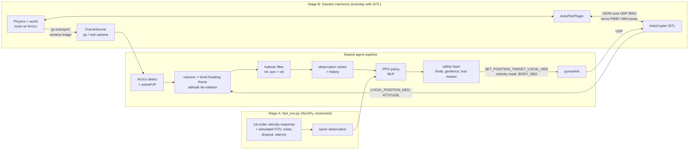

# Architecture

## System overview

Key property: everything inside **Shared agent pipeline** is the same code in
sim and on the real drone. Only `FrameSource` (Gazebo topic vs. USB/CSI camera)
and the MAVLink endpoint (SITL UDP vs. serial to the flight controller) change.

## Design decisions (reviewed in Step 0)

### 1. Action = velocity setpoints in GUIDED mode — agree
- ArduPilot's attitude/rate loops (400 Hz on the FC) absorb motor, prop, mass and
  battery differences; the policy only sees a velocity-tracking system, which is
  approximately a first-order lag in both SITL and reality → small sim-to-real gap.
- Verified in `ArduCopter/GCS_MAVLink_Copter.cpp`: with `MAV_FRAME_BODY_NED`,
  ArduPilot rotates vx/vy by **yaw only** (`body_to_earth2D`), so the command
  frame is "level, heading-aligned", not the tilted body frame.
- Verified in `ArduCopter/Parameters.cpp`: `GUID_TIMEOUT` (default 3 s) — if
  setpoints stop, the copter stops. The runtime must stream at a fixed rate.
- **Challenge:** start with a 3-D action (vx, vy, vz). Yaw is irrelevant for
  landing on a square pad, and each extra action dimension slows learning. Add
  yaw_rate later only if we need to align with the rover's heading.

### 2. Observation = ArUco pose + history + velocity — agree, with one change
- **Challenge:** the camera is rigidly mounted, so when the drone pitches to
  accelerate, the marker moves in the image even if nothing moved in the world.
  The marker pose must be de-rotated by the drone's roll/pitch into the same
  level, heading-aligned frame as the action. Otherwise the policy must learn
  attitude compensation from data, and it will not transfer.
- Feed relative velocity from the Kalman filter rather than raw frame stacking;
  keep a short history (last N filtered states + time-since-last-detection).

### 3. Two-stage training — strongly agree
- Stage B's main jobs are system identification and validation. Fine-tune there
  only if the measured Stage A→B gap requires it (SITL episodes are ~1000×
  slower).

### 4. SB3 first, own PPO later — agree
- SB3 gives a known-good baseline; our own PPO must match its learning curve on
  the same env, which tests our implementation.

### 5. Curriculum — agree, with gating
- Advance stages on **success rate** (e.g. ≥ 80% over the last 200 episodes),
  not fixed step counts.
- Lighting only affects the detector, so it does not exist in Stage A. It is
  domain randomisation in Stage B, not a curriculum stage.

### 6. Training ↔ Gazebo: gz-transport Python bindings, not ROS 2
- Fewer processes and serialisation hops; no DDS discovery issues; no ROS
  PYTHONPATH leaking into the venv.
- "Consistency with deployment" doesn't favour ROS: the real drone has no
  Gazebo topics either. Consistency comes from the `FrameSource` abstraction.
  ROS 2 stays optional, for RViz/rqt visualisation.

### 7. pymavlink, not MAVSDK
- MAVSDK's Offboard plugin is PX4-oriented; with ArduPilot we want direct
  control over `SET_POSITION_TARGET_LOCAL_NED` fields and type_mask, which
  pymavlink exposes 1:1.

## Compute plan
| Machine | Arch | Role |
|---|---|---|
| Laptop (RTX 4050, 20 threads, 15 GB RAM) | x86_64 | Gazebo+SITL (Stage B), dev, eval |
| DGX Spark (GB10, DGX OS / Ubuntu 24.04) | ARM64 | long Stage A sweeps (seeds, ablations) |

ARM64 check (Step 0): torch 2.14.1 has `cu130` aarch64 wheels; SB3/Gymnasium
are pure Python; numpy, opencv-python, onnxruntime and pymavlink all ship
aarch64 wheels; Gazebo Harmonic has arm64 debs for jammy and noble. ROS 2
Humble targets 22.04 only, so on the Spark (24.04) we would use Jazzy or a
22.04 container. That's not needed, since we don't use ROS for training.
